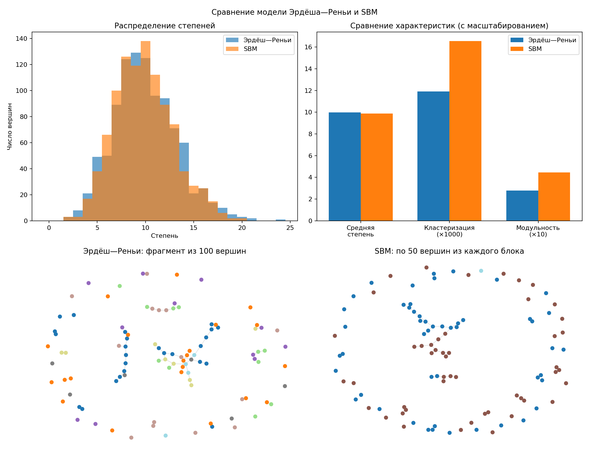

# Задание 2 к лекции 4

Сравнение случайного графа Эрдёша—Реньи и стохастической блочной модели (SBM) с помощью `networkx`.

Используются следующие параметры:

- Эрдёш—Реньи: `n = 1000`, `p = 0.01`;
- SBM: два сообщества по 500 вершин, `p_in = 0.019`, `p_out = 0.001`.

## Что вычисляется

- распределение и среднее значение степеней;
- средний локальный и глобальный коэффициенты кластеризации;
- число компонент и размер гигантской компоненты;
- средняя длина пути в гигантской компоненте;
- средняя длина пути по всем связным парам вершин;
- сообщества методом жадной максимизации модульности;
- модульность разбиения;
- состав найденных групп SBM и их сравнение с двумя исходными блоками.

## Запуск

Из корня проекта:

```bash
cd task_4
../.venv/bin/python main.py | tee output.txt
```

Программа создает `task_4_results.png` с распределениями степеней, сравнением характеристик и фрагментами сетей. Цвета вершин обозначают найденные группы. На рисунке показана только часть вершин и рёбер, поэтому разрывы во фрагменте не означают, что вся сеть несвязна.

## Вывод

В обеих сетях у вершины в среднем около 10 соседей, но связи устроены по-разному. В модели Эрдёша—Реньи у любой пары вершин одинаковый шанс соединиться. В SBM связи внутри двух заданных групп появляются чаще, чем между ними. Значит, одинаковое среднее число соседей ещё не означает одинаковое устройство сети.

У полученной сети SBM выше кластеризация: `0.0166` против `0.0119`, примерно в `1.39` раза. Это означает, что соседи одной вершины чаще связаны друг с другом. Модульность тоже выше: `0.445` против `0.278`. Этот показатель оценивает, насколько сильно связи сосредоточены внутри найденных групп по сравнению со случайным распределением связей. Алгоритм выделил в SBM две большие группы из 500 и 496 вершин, почти совпадающие с исходными блоками, и дополнительную маленькую группу из 4 вершин. В графе Эрдёша—Реньи алгоритм тоже нашёл группы, но заранее их в модель не закладывали: они появились из-за случайного расположения рёбер.

Обе полные сети связны: от любой вершины можно добраться до любой другой. При этом средний кратчайший путь в SBM немного длиннее — `3.43` ребра против `3.26` у Эрдёша—Реньи. Это согласуется с тем, что между группами SBM связей мало и переходить из одной группы в другую труднее.

Численные результаты находятся в [output.txt](output.txt).


